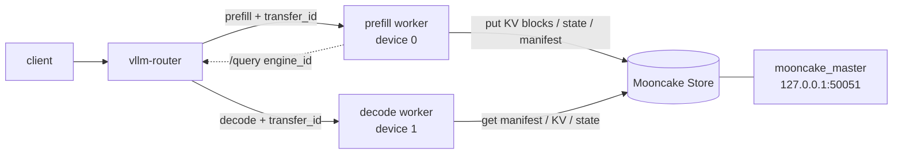
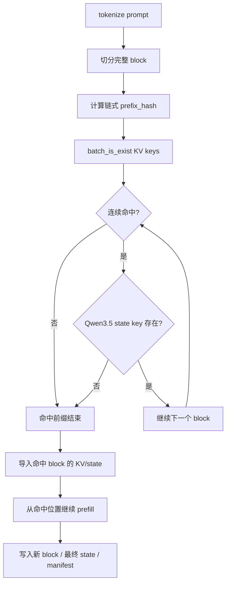
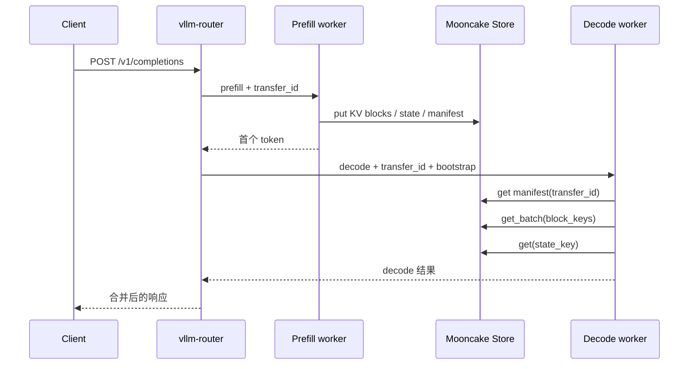

# Mooncake KV 存储、前缀匹配与 Decode 拉取设计

## 1. 设计范围与结论

本文定义 nano-vllm 在 Prefill/Decode 分离场景下使用 Mooncake Store 保存 KV cache 的方案。方案包含三个能力：KV 对象的分布式存储、跨请求的前缀匹配、Decode 侧主动拉取 KV。目标运行环境是 A3 NPU 双卡，Mooncake 使用 TCP 传输和本地 master，不依赖 RDMA。

结论是采用“共享对象存储 + 确定性前缀键 + manifest 交接”的结构。prefill worker 把每个 KV block、每个前缀边界的状态快照和一个请求 manifest 写入 Mooncake Store；router 只转发 `transfer_id`；decode worker 用 `transfer_id` 读取 manifest，再批量拉取 KV 和状态。前缀匹配发生在 prefill worker，按完整 block 计算链式哈希，只复用连续命中的前缀。

当前 HTTP 中转基线位于 `nanovllm/serving/pd_worker.py`：prefill 在 `PrefillWorkerRouter.generate` 中调用 `LLMEngine.prefill`，把序列化结果存入 `PDTransferStore`，返回 `kv_transfer_params.nano_pd`；decode 在 `_fetch_payload` 中通过 `/internal/pd/transfer/{id}` 拉取。该路径的数据只在单个 prefill 进程内暂存，不能跨请求复用，也不能让 decode 独立定位数据。Mooncake 方案把数据面从 worker 内部内存搬到共享存储，解决这两个限制。

本方案不追求与 vLLM 原生 Mooncake connector 的 KV 布局兼容。nano-vllm 的 KV cache 形状、Qwen3.5 线性注意力状态和 block 管理与 vLLM 不同，因此只复用 vllm-router 的 Mooncake 控制面字段，数据对象格式由 nano-vllm 自己定义。

## 2. 术语与现有基线

| 术语 | 含义 | 边界 |
| --- | --- | --- |
| KV block | paged KV cache 的一个固定大小槽位，当前 `kvcache_block_size=256` | 只包含 full-attention 层 |
| 前缀哈希 | 从第 0 个 token 到当前 block 末尾的链式哈希 | 只对完整 block 计算 |
| 状态快照 | Qwen3.5 线性注意力在某个前缀边界的 `conv_state` 和 `recurrent_state` | 每个快照约 20 MiB |
| manifest | 一次请求的交接清单，记录 token、block key、state key 和首个 token | 以 `transfer_id` 为键 |
| transfer_id | router 为一次 P/D 交接生成的关联 ID，格式 `xfer-<uuid>` | 同一次请求的 P、D 两阶段相同 |
| D pull | decode worker 主动从共享存储读取 KV | prefill 不向 decode 推送数据 |
| Mooncake Store | 分布式对象存储，提供 `put/get/batch_is_exist` 等字节级接口 | 需要 `mooncake_master` |
| segment | Mooncake client 贡献给集群的 DRAM 容量 | 每个 worker 独立配置 |

Mooncake Store 的 Python 入口是 `mooncake.store.MooncakeDistributedStore`，核心调用为 `setup`、`put`、`get`、`put_batch`、`get_batch`、`batch_is_exist`、`remove` 和 `close`。`mooncake_master` 负责对象放置和集群成员管理，默认 RPC 端口是 50051。当前验证使用 `mooncake-transfer-engine-non-cuda==0.3.14` 的 aarch64 wheel，`metadata_server="P2PHANDSHAKE"`，`protocol="tcp"`。在本地 aarch64 CPU 节点上，3 MiB 对象的 `put`/`get` 约为 2 ms/1 ms，20 MiB 对象约为 12 ms/7 ms；这些是本地回环测量，不是 NPU 或 RDMA 指标。

已有 `LLMEngine.prefill` 在 `nanovllm/engine/llm_engine.py:84` 执行 prompt prefill，并在结束时通过 `ModelRunner.export_kv` 和 `export_state` 导出 KV/state；`LLMEngine.import_prefilled` 在 `nanovllm/engine/llm_engine.py:115` 把外部结果导入 decode 引擎。`ModelRunner` 的四个数据面方法位于 `nanovllm/engine/model_runner.py:268` 到 `:282`。Mooncake 方案复用这些导出/导入接口，不改变模型计算路径。

## 3. 总体架构



控制面与数据面分离。router 只选择 prefill/decode worker，并注入 `transfer_id`；它不搬运 KV tensor。prefill worker 把 KV、状态和 manifest 写入 Mooncake Store；decode worker 按 `transfer_id` 读取。Mooncake master 管理对象位置，prefill 和 decode 各自作为 client 贡献一段 DRAM segment。

一次请求的时序如下：

1. router 收到客户端请求，生成 `transfer_id`，向 prefill worker 发送 `max_tokens=1` 的 prefill 请求。
2. prefill worker 计算前缀匹配，执行剩余 prefill，写 KV/state/manifest 到 Mooncake。
3. prefill 返回首个 token；router 把 `transfer_id`、bootstrap 地址和 engine ID 放入 decode 请求。
4. decode worker 读取 manifest，批量拉取 KV/state，导入本地引擎并继续 decode。
5. decode 返回最终文本；router 合并 usage 并返回客户端。

## 4. Mooncake KV 存储

### 4.1 对象划分

Mooncake 方案使用三类对象，分别承担数据、状态和交接控制。按对象拆分而不是把整条请求打包成一个 blob，是为了让前缀匹配可以按 block 粒度命中，也让 decode 可以批量拉取。

| 对象 | 键格式 | 内容 | 典型大小 |
| --- | --- | --- | --- |
| 完整前缀 KV block | `nano:kv:v1:{scope}:{prefix_hash}` | 可被后续请求复用的单个 block | 3 MiB |
| 请求内 KV block | `nano:kv:req:{transfer_id}:{index}` | 最后一个不完整 block 或首 token 所在 block | 3 MiB |
| 完整前缀状态快照 | `nano:state:v1:{scope}:{prefix_hash}` | 可被后续请求复用的 block 边界状态 | 约 20 MiB |
| 请求最终状态 | `nano:state:req:{transfer_id}` | decode 导入用的最终状态 | 约 20 MiB |
| manifest | `nano:manifest:v1:{transfer_id}` | 请求 token、block key、state key、首 token | 1–4 KiB |

`scope` 是模型和布局的命名空间，避免不同模型、dtype 或 block size 的对象互相命中。它由模型路径指纹、`text_config.dtype`、`kvcache_block_size`、KV 层数、KV head 数和对象格式版本组成，例如 `qwen3_5-0_8b-bf16-256-l6-h2-d256-v1`。模型配置变化时必须改变 `scope`，否则旧对象可能被错误复用。

只有完整 block 使用前缀键，最后一个不完整 block 和首个生成 token 所在 block 使用请求内键。前缀匹配只查询完整 block 的前缀键，因此不会把“同一段 token 出现在不同位置”误判为同一前缀。manifest 同时记录两类键，decode 按顺序拉取即可。Qwen3.5 的前缀匹配还要求对应边界的状态快照存在；请求最终状态只服务本次 decode，不参与后续前缀命中。

KV block 的 payload 使用 `torch.save({"version": 1, "block": tensor})` 生成字节串，tensor 形状为 `[2, num_kv_layers, 1, block_size, num_kv_heads, head_dim]`。Qwen3.5-0.8B 的 full-attention 层数为 6，`num_key_value_heads=2`，`head_dim=256`，block size 为 256，bf16 每个元素 2 字节：

```text
2 (K/V) × 6 (layers) × 256 (tokens) × 2 (kv heads) × 256 (head dim) × 2 bytes
= 3,145,728 bytes
= 3 MiB
```

状态快照的 payload 使用 `torch.save({"version": 1, "state": list})` 生成。Qwen3.5 有 18 个 linear-attention 层，每层包含 `conv_state` 和 `recurrent_state`；实测单 block 前缀的序列化状态约 20 MiB，远大于 3 MiB 的 KV block。这个差异决定了状态快照不能按任意 token 粒度保存，只能按 block 边界或最终边界保存。

manifest 使用 UTF-8 JSON，字段如下：

| 字段 | 含义 |
| --- | --- |
| `version` | 对象格式版本 |
| `transfer_id` | router 生成的 P/D 关联 ID |
| `engine_id` | prefill worker 的 Mooncake engine ID |
| `model_scope` | 模型与布局命名空间 |
| `token_ids` | prompt 加首个生成 token 的完整 token 列表 |
| `num_prompt_tokens` | prompt token 数 |
| `block_keys` | 每个 KV block 的对象键，按顺序排列 |
| `prefix_hashes` | 每个完整 block 的前缀哈希 |
| `state_key` | 最终状态快照的对象键 |
| `first_token` | prefill 采样的首个 token |
| `eos_token_id` | 用于 decode 判断是否立即结束 |
| `block_size` | KV block 的 token 容量 |
| `kv_shape` | KV tensor 的维度信息 |
| `created_at` | 写入时间，用于排查 |

### 4.2 容量与延迟

按上面的对象大小，一个 512 token 的 Qwen3.5 请求包含 2 个 KV block 和 2 个 block 边界状态快照（block 策略）。容量为：

```text
2 × 3 MiB (KV) + 2 × 20 MiB (state) = 46 MiB
```

如果只保存最终状态（`final` 策略），容量为：

```text
2 × 3 MiB (KV) + 1 × 20 MiB (state) = 26 MiB
```

一个 1 GiB 的 client segment 在 `block` 策略下大约能容纳 22 个这样的请求，在 `final` 策略下大约容纳 39 个；两个 worker 各贡献 1 GiB 时，容量翻倍。这个量级只适合功能验证和小流量，生产环境需要按请求速率、保留时间和 eviction 策略配置 segment 与 SSD offload。

本地 TCP 回环的 3 MiB/20 MiB `put`/`get` 实测在毫秒级，主要成本是对象数量、序列化和 Mooncake 的元数据 RPC。前缀命中可以省掉 prefill 计算，但 decode 仍要拉取全部命中 block 的 KV；因此前缀匹配主要降低 prefill 算力，不降低 decode 的 KV 读取量。

### 4.3 客户端配置

prefill 和 decode 都创建 `MooncakeDistributedStore`，使用相同的 master、metadata、protocol 和 tenant。`setup` 的关键参数如下：

```python
store.setup(
    local_hostname="127.0.0.1",
    metadata_server="P2PHANDSHAKE",
    global_segment_size=1024 * 1024 * 1024,
    local_buffer_size=256 * 1024 * 1024,
    protocol="tcp",
    rdma_devices="",
    master_server_addr="127.0.0.1:50051",
    tenant_id="default",
)
```

`global_segment_size` 是 client 贡献给集群的 DRAM，`local_buffer_size` 是 Transfer Engine 的本地缓冲区。两者不能超过容器可用内存，且需要给模型权重、KV cache 和状态缓存留出空间。demo 使用 1 GiB segment 和 256 MiB buffer；如果只做单请求验证，可以降到 256 MiB/64 MiB。

Mooncake 的 `put/get` 是同步接口，在 asyncio 服务中必须通过 `asyncio.to_thread` 调用，避免阻塞事件循环。批量接口优先使用 `put_batch`、`get_batch` 和 `batch_is_exist`，减少 RPC 次数。对象不存在时 `get` 返回空字节串，`batch_is_exist` 返回 0；不能把空字节串当成合法 payload。

## 5. 前缀匹配

### 5.1 匹配定义

前缀匹配寻找“从第 0 个 token 开始、长度为 block_size 整数倍、且 KV 与状态都存在”的最长前缀。只匹配完整 block，避免处理部分 block 的有效 token 边界。匹配结果是一个 block 数量 `k`，对应 `k × block_size` 个 token；后续 prefill 从该位置继续。

哈希采用链式 SHA-256，而不是对单个 block 独立哈希：

```text
h0 = SHA256(scope || block0_tokens)
h1 = SHA256(h0 || block1_tokens)
h2 = SHA256(h1 || block2_tokens)
```

链式哈希保证“命中第 i 个 block”意味着从第 0 个 block 到第 i 个 block 的 token 序列完全一致。如果只对单个 block 做哈希，相同 block 出现在不同前缀位置时可能被错误复用。`scope` 参与第一层哈希，模型或布局变化时不会命中旧对象。

### 5.2 匹配流程



匹配时先批量查询所有完整 block 的 KV key，再从第 0 个 block 开始检查连续性。遇到第一个缺失或 `batch_is_exist` 返回负值就停止，不再向后跳跃匹配。对 Qwen3.5，还要检查该边界的状态 key；状态缺失时把命中长度回退到上一个有状态的边界。全 attention 模型没有状态 key，只需要检查 KV。

### 5.3 Qwen3.5 状态边界

Qwen3.5 的 18 个 linear-attention 层维护逐序列的 `conv_state` 和 `recurrent_state`，它们不是 block 局部量。只导入 KV block 而不导入对应状态，会让后续 linear-attention 计算从零状态开始，输出错误。方案在每个完整 block 边界保存状态快照，键使用该边界的前缀哈希；前缀匹配只有在 KV 和 state 同时命中时才成立。

为了让状态快照与 block 边界对齐，prefill worker 在 Mooncake 模式下把 `max_num_batched_tokens` 限制为 `kvcache_block_size`（当前 256）。这样每次调度最多推进一个 block，prefill 循环可以在每个 block 结束时导出状态。该限制只作用于启用 Mooncake 前缀匹配的 prefill worker，不影响 Regular worker 或 HTTP 模式的 prefill。

状态快照有三种策略：

| 策略 | 行为 | 适用场景 | 代价 |
| --- | --- | --- | --- |
| `block` | 每个完整 block 边界都保存状态 | 任意 block 前缀复用 | 约 20 MiB/边界 |
| `final` | 只保存请求最终状态 | 重复完整 prompt 或 decode 拉取 | 只能复用最终边界 |
| `none` | 不保存状态 | 全 attention 模型 | Qwen3.5 前缀匹配不可用 |

Qwen3.5 demo 使用 `block` 策略，512 token 请求约 46 MiB；如果只关心 decode 拉取而不关心前缀复用，使用 `final` 策略把容量降到 26 MiB。

### 5.4 导入与续算

前缀命中后的导入路径复用现有引擎接口：

1. `BlockManager.import_sequence` 分配 `k` 个 block 和一个 state slot。
2. `ModelRunner.import_kv` 把 Mooncake 拉取的 KV tensor 写入这些 block。
3. `ModelRunner.import_state` 把状态快照写入该 slot。
4. 设置 `seq.num_cached_tokens = k × block_size`，把序列放回 scheduler。
5. 如果命中长度等于 prompt 长度，把 `num_cached_tokens` 回退 1 个 token，让最后一个 token 重新经过模型以产生 logits 和首个采样 token。
6. 对全 attention 模型，导入 block 同时写入本地 `BlockManager` 的 xxhash 链，避免外部前缀与本地前缀缓存同时启用时链式哈希从 `-1` 起步。Qwen3.5 关闭本地前缀缓存，不依赖这一步。

`LLMEngine.prefill` 当前在 `nanovllm/engine/llm_engine.py:84` 只接受普通 prompt；方案增加一个可选的 `external_prefix` 参数，或新增 `prefill_with_external_prefix` 方法，避免影响现有 HTTP 和 Regular 路径。

### 5.5 示例

prompt 长度为 600 token，block size 为 256，完整 block 为 2 个（512 token），最后 88 token 是部分 block。如果两个 block 的 KV 和 512 边界状态都命中，prefill 只计算最后 88 token；如果只有第一个 block 命中，prefill 从 256 开始计算 344 token；如果第二个 block 的 KV 存在但 state 缺失，命中回退到 256。部分 block（88 token）不参与前缀匹配，必须重新计算。

## 6. Decode 侧拉取

### 6.1 交接时序



Decode 不依赖 prefill 的 HTTP 地址。prefill 只需要把对象写入共享存储，router 把 `transfer_id` 传给 decode；decode 用 manifest 定位 block 和 state。这样 prefill 和 decode 可以独立扩缩容，prefill 也不需要知道哪个 decode 会接手。

### 6.2 Manifest 与 token 对齐

router 的 Mooncake connector 在 decode 请求中只保留 `transfer_id`、`remote_bootstrap_addr` 和 `remote_engine_id`，不会转发 prefill 响应里的自定义 `kv_transfer_params`。因此 prefill 必须把首个 token、prompt token 和 block key 写入 manifest，decode 才能在没有 prefill 响应体的情况下完成交接。

decode 读取 manifest 后依次校验 `model_scope`、`block_size`、`token_ids` 长度和 `num_prompt_tokens`。校验失败时不能猜测布局，应返回明确错误或按配置回退到完整生成。manifest 的 `engine_id` 可以与 router 传入的 `remote_engine_id` 对比，用于发现路由到了错误的 prefill 实例。

### 6.3 导入流程

decode 使用 `get_batch(block_keys)` 一次拉取所有 KV block，反序列化后按 block 顺序拼成 `[2, layers, N, block_size, heads, dim]` 的 CPU tensor；再 `get(state_key)` 拉取状态。随后构造 `prefill_result`：

```python
prefill_result = {
    "token_ids": manifest["token_ids"],
    "prompt_token_ids": manifest["token_ids"][: manifest["num_prompt_tokens"]],
    "num_prompt_tokens": manifest["num_prompt_tokens"],
    "block_table": [0] * len(manifest["block_keys"]),
    "kv": kv_tensor,
    "state": state,
    "sampling_params": sampling_params,
    "finished": False,
}
```

`AsyncLLMEngine.add_prefilled` 会调用现有的 `LLMEngine.import_prefilled`，把 KV/state 导入本地缓存并开始 decode。该路径与当前 HTTP 模式的 decode 导入逻辑一致，只是数据来源从 `/internal/pd/transfer/{id}` 变成 Mooncake 的 `get_batch`。

### 6.4 缺失与回退

decode 可能遇到 manifest 缺失、block 缺失、state 缺失或 payload 损坏。默认策略是返回明确错误，避免“看起来成功但 KV 不完整”的静默错误；可配置 `--mooncake-missing-policy recompute`，在 manifest 缺失时让 decode 退回本地完整生成。回退会破坏 PD 分离的语义，但能保证可用性，必须记录 `fallback_count` 指标。

prefill 侧的前缀缺失不是错误：前缀未命中时从第 0 个 token 开始 prefill，仍然写新的 KV 和 manifest。只有 decode 拉取失败才是请求级错误。

## 7. 与 vllm-router 的衔接

router 的 Mooncake 模式由 `--kv-connector mooncake` 启用。静态 URL 模式下，router 启动时对每个 prefill URL 的 bootstrap 端口发起 `/query` 查询；默认端口是 8998，也可以通过 `--prefill URL 8998` 显式指定。查询失败会让 router 启动失败，而不是带着不完整的 handoff 信息运行。

prefill worker 需要一个轻量 bootstrap HTTP 服务，返回：

```json
{
  "0": {
    "engine_id": "nano-prefill-1-3f2a9c"
  }
}
```

`engine_id` 在 prefill 进程启动时生成，写入 manifest 并在 `/query` 中返回。多 P 部署时，每个 prefill worker 使用不同的 bootstrap 端口（8998、8999 等），router 的每个 `--prefill` 条目带自己的端口。

Mooncake 模式下 router 注入的字段如下：

| 阶段 | 字段 | 用途 |
| --- | --- | --- |
| prefill | `do_remote_decode=true` | 告诉 prefill 这是远端 decode |
| prefill | `do_remote_prefill=false` | prefill 不拉取远端 KV |
| prefill | `transfer_id` | manifest 键 |
| decode | `do_remote_prefill=true` | decode 需要拉取 KV |
| decode | `do_remote_decode=false` | decode 不再触发远端 decode |
| decode | `transfer_id` | manifest 键 |
| decode | `remote_bootstrap_addr` | prefill 的 bootstrap 地址 |
| decode | `remote_engine_id` | prefill 的 engine ID |

nano-vllm 的数据面不使用 `remote_bootstrap_addr` 和 `remote_engine_id` 搬运数据，但保留它们用于校验和排查。真正的数据定位依赖 `transfer_id` 和 manifest。

## 8. 配置与接口

worker 启动参数按“存储后端、Mooncake 连接、前缀策略、回退策略”分组：

| 参数 | 默认值 | 作用 |
| --- | --- | --- |
| `--kv-store` | `http` | `http` 使用现有中转，`mooncake` 使用共享存储 |
| `--mooncake-master` | `127.0.0.1:50051` | master RPC 地址 |
| `--mooncake-metadata` | `P2PHANDSHAKE` | metadata 连接串 |
| `--mooncake-protocol` | `tcp` | `tcp`、`rdma`、`ascend` 等 |
| `--mooncake-global-segment-size` | `1073741824` | client 贡献的 DRAM 字节数 |
| `--mooncake-local-buffer-size` | `268435456` | Transfer Engine 本地缓冲区 |
| `--mooncake-tenant` | `default` | 对象命名空间 |
| `--mooncake-bootstrap-port` | `8998` | prefill `/query` 端口 |
| `--mooncake-state-snapshots` | `block` | `block`、`final`、`none` |
| `--mooncake-missing-policy` | `error` | `error` 或 `recompute` |

核心模块与职责：

| 模块 | 职责 |
| --- | --- |
| `nanovllm/serving/mooncake_store.py` | Mooncake client 封装、配置、批量读写、错误转换 |
| `nanovllm/serving/prefix_cache.py` | 链式哈希、key 构造、最长前缀查询 |
| `nanovllm/serving/pd_mooncake.py` | manifest 编解码、prefill 发布、decode 拉取 |
| `nanovllm/serving/pd_worker.py` | 在 prefill/decode 路由中接入 Mooncake 路径 |
| `nanovllm/serving/api_server.py` | CLI 参数、bootstrap `/query` 服务 |
| `nanovllm/engine/llm_engine.py` | 外部前缀 prefill、状态快照回调 |
| `nanovllm/engine/model_runner.py` | 批量导入 KV block |
| `nanovllm/engine/block_manager.py` | 外部 block 导入与 `num_cached_tokens` 设置 |

`MooncakeStoreClient` 的接口保持最小集合：`setup`、`put`、`get`、`put_batch`、`get_batch`、`batch_is_exist`、`remove`、`close`。所有调用同步执行，由上层用 `asyncio.to_thread` 包装。对象不存在时返回 `None` 或空字节串，由上层转换成业务错误，不把 Mooncake 的错误码直接暴露给 HTTP 客户端。

## 9. 失败模式与边界

| 失败 | 表现 | 处理 |
| --- | --- | --- |
| master 未启动 | client `setup` 失败或请求超时 | worker 启动失败，打印 master 地址和排查命令 |
| bootstrap 未就绪 | router `/query` 失败 | router 启动失败，不进入不完整 PD 状态 |
| KV key 缺失 | 前缀命中在缺失处停止 | 从该位置重新 prefill，不报错 |
| state key 缺失 | Qwen3.5 前缀回退到上一个有状态边界 | 重新计算该边界之后的 token |
| manifest 缺失 | decode 无法定位数据 | 默认返回 503/500；`recompute` 模式回退完整生成 |
| block 部分缺失 | decode 拉取到空对象 | 校验 block 数量，拒绝导入 |
| payload 损坏 | `torch.load` 或 shape 校验失败 | 返回明确错误，不使用该对象 |
| 对象被驱逐 | `get` 返回空 | 前缀未命中或 decode 回退 |
| 并发写同一前缀 | 多个 prefill 同时写相同 key | 对象内容确定性相同，允许覆盖；manifest 以 `transfer_id` 隔离 |
| 模型或 dtype 变化 | `scope` 不匹配 | 不会命中旧对象，避免错误复用 |
| 多 P bootstrap 端口冲突 | 第二个 prefill 无法启动 `/query` | 每个 P 使用独立端口，脚本显式分配 |
| 存储带宽不足 | decode 拉取变慢或超时 | 批量读取、限制并发、增加 segment 或 SSD offload |

前缀匹配的边界是“完整 block + 连续命中 + 状态存在”。这意味着最后一个不完整 block 永远不命中，长 prompt 的尾部仍需计算。状态快照策略 `block` 的存储成本很高，生产环境需要评估是否值得为任意前缀命中付出约 20 MiB/block 的代价；如果请求之间前缀共享较少，使用 `final` 或关闭状态快照更划算。

## 10. 验证矩阵

验证分为单元、存储、前缀、D pull 和端到端五层。每层都需要可重复的命令和明确的通过条件。

| 层级 | 验证内容 | 通过条件 |
| --- | --- | --- |
| 单元 | 链式哈希、key 构造、manifest 编解码 | 固定 token 序列的 key 稳定；manifest 往返一致 |
| 存储 | Mooncake master + client `put/get/batch` | 3 MiB 和 20 MiB 对象读写一致 |
| 前缀 | 两次请求共享前缀 | 日志出现 `prefix_hit_blocks > 0`，输出与直接生成一致 |
| D pull | decode 从 Mooncake 拉取 | decode 日志出现 `get_batch`，无 `/internal/pd/transfer` 请求 |
| 端到端 | router `--kv-connector mooncake` | curl 非流式/流式/chat 通过，`pd_transfer=true`，`kv_store=mooncake` |
| 回归 | 原有 HTTP PD、Regular S3/S4 | 原有脚本继续通过 |

前缀命中的对拍方法与现有 PD 验证一致：`temperature=0`，将 router 返回文本与单请求直接 `LLMEngine.generate` 的结果比较，要求完全一致。D pull 的验证同时检查 Mooncake `put/get` 计数和 decode 日志，避免只看响应文本而误判数据来源。

A3 NPU 实机已经跑通上述链路。`scripts/verify_mooncake_store.py` 在远端 NPU 上对 3 MiB 和 20 MiB 对象完成 `put/get` 往返，3 MiB 约 8 ms 写入、2 ms 读取，20 MiB 约 18 ms 写入、11 ms 读取。`scripts/verify_mooncake_pd.py` 使用 404 token 的共享前缀发送两次请求：第一次 `prefix_hit_blocks=0`，第二次 `prefix_hit_blocks=1`，两次 `kv_store=mooncake`、`pd_transfer=true`；prefill 日志中 `/internal/pd/transfer` 请求数为 0，说明 decode 确实从 Mooncake 拉取。两次返回文本与单请求直接生成完全一致。

实现对应关系如下：

| 模块 | 职责 |
| --- | --- |
| `nanovllm/serving/mooncake_store.py` | Mooncake client 封装和错误归一化 |
| `nanovllm/serving/prefix_cache.py` | 链式哈希、前缀键、最长前缀查询 |
| `nanovllm/serving/pd_mooncake.py` | manifest、KV/state 编解码、prefill 发布和 decode 拉取 |
| `nanovllm/serving/pd_worker.py` | Mooncake prefill/decode 路由分支、bootstrap server 生命周期 |
| `nanovllm/engine/llm_engine.py` | `prefill_with_prefix` 和 block 边界回调 |
| `nanovllm/engine/model_runner.py` | 批量 KV block 导入 |
| `nanovllm/engine/block_manager.py` | 外部前缀 block/state slot 分配 |

## 11. 设计取舍

Mooncake Store 相比当前 HTTP 中转的收益是共享存储、跨请求前缀复用和 decode 主动拉取；代价是新增 master、client segment、序列化和对象管理。对于单请求、无前缀复用的场景，Mooncake 的额外 RPC 和序列化成本不会带来收益，HTTP 中转更简单。对于多请求共享长前缀、需要 P/D 解耦和横向扩展的场景，共享存储的价值才体现出来。

按 block 拆对象而不是整请求打包，使前缀匹配可以按 block 命中，但也带来更多对象和 RPC。按 manifest 交接而不是把元数据塞进 `transfer_id`，使 decode 能在 router 丢弃 prefill 响应体的情况下恢复完整上下文；代价是多一次 manifest 读取。按 block 边界保存 Qwen3.5 状态，保证前缀复用的正确性，但状态快照大小约为 KV block 的 6.7 倍，是方案中最主要的容量成本。

TCP 是当前 NPU 环境的可用传输方式，RDMA 或 Ascend 专用传输可以在不改变对象格式和 key 布局的前提下替换。Mooncake 的 `protocol` 参数和 `rdma_devices` 已经为这种替换留出接口，但本文不把 RDMA 性能作为验证目标。
