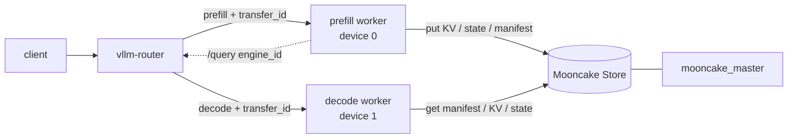

# nano-vllm 在线服务

本文按服务拓扑组织验证场景。每个场景先给拓扑和启动方式，再给 curl 直发请求，最后给自动化验证脚本。

运行环境以 NPU 为准；CPU 只用于数值对拍和快速调试。

术语：

- **Regular worker**：通过 vllm-router 的 `--worker-urls` 注册，单个实例内完成 prefill 和 decode，P/D 不分离。本文把这种形态称为“Regular 单实例（P/D 混部）”。
- **PD worker**：通过 vllm-router 的 `--vllm-pd-disaggregation` 注册，prefill 和 decode 是独立进程，分别运行在不同 device 上。

## 1. 场景总览

| 编号 | 场景 | 拓扑 | 设备/进程 | 入口 | 自动化脚本 | NPU 状态 |
| --- | --- | --- | --- | --- | --- | --- |
| S1 | 异步引擎直调 | 进程内 `AsyncLLMEngine` | 1 个引擎，device 0 | Python API | `verify_async_engine.py` | 已验证 |
| S2 | 单 worker HTTP 直连 | 1 个 API Server，无 router | 1 个进程，device 0 | OpenAI `/v1/*` | `verify_api_server.py` | 已验证 |
| S3 | Regular 单实例（P/D 混部） | 1 个 Regular worker + vllm-router | 1 个进程，device 0 | router 的 `/v1/*` | `verify_router_regular.py` 的 S3 部分 | 已验证 |
| S4 | Regular DP=2 | 2 个 Regular worker + vllm-router | 2 个进程，device 0/1 | router 的 `/v1/*` | `verify_router_regular.py` 的 S4 部分 | 已验证 |
| S5 | PD 分离 1P1D | 1 个 prefill + 1 个 decode + vllm-router | 2 个进程，device 0/1 | router 的 `/v1/*` | `verify_pd_router.py`、`run_pd_router_demo.sh` | 已验证 |
| S6 | PD 分离多 P/多 D | N 个 prefill + M 个 decode + vllm-router | 至少 3 个 worker 槽位 | router 的 `/v1/*` | 需扩展脚本或手工 curl | 代码已支持；CPU 已验证 2P1D，NPU 受 2 卡限制未展开 |
| S7 | Mooncake KV 存储与 Decode 拉取 | 1P1D + Mooncake Store | 2 个 worker + master | router 的 `/v1/*` | `verify_mooncake_pd.py`、`run_mooncake_pd_demo.sh` | NPU 已验证 |

对应关系：

- 需求 1：单个 Regular worker 实例（P/D 混部）→ S3。
- 需求 2：在 1 的基础上 DP=2，两个 Regular worker → S4。
- 需求 3：PD 分离，P 和 D 在不同 device → S5。
- 需求 4：PD 分离，多个 P/D 实例 → S6。代码当前已支持，受 device 数量限制，NPU 上暂只验证 1P1D。
- S1、S2 保留。

说明：

- “CPU / NPU”是运行环境，不是独立场景。
- “curl 直发 / 自动化脚本”是验证方式，每个场景都会同时给出。

## 2. 通用准备

### 2.1 NPU 环境

```bash
source /home/developer/Ascend/cann-9.3.0/set_env.sh
cd /mnt/workspace/Works/nano-vllm
source /mnt/workspace/Envs/nano_vllm_a3/bin/activate
export NANO_VLLM_MODEL=/home/developer/models/models/Qwen--Qwen3.5-0.8B/snapshots/master
```

确认设备和模型：

```bash
npu-smi info
ls "$NANO_VLLM_MODEL"
```

### 2.2 服务依赖

```bash
pip install -e '.[serving]'
```

`serving` extra 包含 `fastapi`、`uvicorn`、`pydantic`、`httpx`。A3 环境也可以继续使用：

```bash
bash scripts/setup_a3_env.sh
```

### 2.3 vllm-router

S3-S6 需要 vllm-router。仓库外的 `../vllm-router` 提供两种产物：

```bash
# 方式一：Rust 二进制
export VLLM_ROUTER_BIN=/mnt/workspace/Works/vllm-router/target/release/vllm-router

# 方式二：安装 whl
pip install --force-reinstall /mnt/workspace/Works/vllm-router/dist/vllm_router-*.whl
```

没有设置 `VLLM_ROUTER_BIN` 时，脚本会依次查找 `vllm-router` 命令和 `../vllm-router/target/release/vllm-router`。

### 2.4 CPU 说明

CPU 只用于数值对拍和快速调试，不作为服务化复现环境。CPU 上可以运行 S1、S2，也可以用 S3/S4 排查 router 链路：

```bash
python scripts/verify_async_engine.py
python scripts/verify_router_regular.py
```

## 3. 组件与异步模型

### 3.1 组件

| 组件 | 位置 | 作用 |
| --- | --- | --- |
| `AsyncLLMEngine` | `nanovllm/serving/async_engine.py` | 在 asyncio 事件循环内包装 `LLMEngine`，为每个请求提供异步事件流 |
| API Server | `nanovllm/serving/api_server.py` | 基于 FastAPI 的 OpenAI 风格 HTTP 服务；`--role regular` 即 Regular worker |
| `SingleRouter` / `RoundRobinRouter` | `nanovllm/serving/router.py` | 单引擎或同进程多引擎选择 |
| `PDRouter` | `nanovllm/serving/pd.py` | 单进程 Prefill / Decode 分离，非主路径 |
| `PrefillWorkerRouter` | `nanovllm/serving/pd_worker.py` | 独立 prefill worker，导出 KV/state |
| `DecodeWorkerRouter` | `nanovllm/serving/pd_worker.py` | 独立 decode worker，拉取并导入 KV/state |
| `PDTransferStore` | `nanovllm/serving/pd_transfer.py` | prefill worker 上的 KV/state 暂存与 TTL 清理 |

### 3.2 AsyncLLMEngine

`AsyncLLMEngine` 复用 `LLMEngine` 的调度和模型执行，对上层提供：

- `generate(prompt, sampling_params, request_id=None, stop=None)`：异步生成器，逐事件返回结果。
- `add_prefilled(prefill_result, request_id, stop=None)`：导入 prefill 结果并开始 decode。
- `stream(request_id)`：继续消费已注册请求的事件流。
- `abort(request_id)`：中止请求。
- `shutdown()`：关闭后台任务和引擎。

`AsyncLLMEngine` 必须在运行中的 asyncio 事件循环内构造，不能在循环外提前创建。

### 3.3 事件格式

每个事件是一个字典：

| 键 | 含义 |
| --- | --- |
| `request_id` | 请求标识 |
| `seq_id` | 引擎内部的序列 ID |
| `token_ids` | 截至当前已生成的 completion token ID |
| `text` | 截至当前已解码的完整文本 |
| `delta_text` | 相对上一个事件的增量文本 |
| `finished` | 是否已结束 |
| `num_prompt_tokens` | prompt token 数 |
| `num_generated_tokens` | 已生成 token 数 |
| `finish_reason` | 结束原因，未结束时为 `null`，结束时通常为 `stop` 或 `length` |

最后一个事件的 `finished` 为 `true`。调用方应以该事件作为完成标志。

## 4. S1 异步引擎直调

### 4.1 使用方式

不经过 HTTP，直接在 Python 进程内使用 `AsyncLLMEngine`：

```python
import asyncio

from nanovllm import SamplingParams
from nanovllm.serving.async_engine import AsyncLLMEngine

async def main():
    engine = AsyncLLMEngine(
        "/path/to/model",
        device_id=0,
        enforce_eager=True,
        max_model_len=512,
        max_num_seqs=8,
        max_num_batched_tokens=512,
    )
    params = SamplingParams(temperature=0.0, max_tokens=8)
    async for event in engine.generate("What is 1+1?", params):
        print(event["delta_text"], event["finished"])
    await engine.shutdown()

asyncio.run(main())
```

### 4.2 自动化验证

```bash
python scripts/verify_async_engine.py
```

验证内容：构造 `AsyncLLMEngine`，发起一次异步生成，检查收到非空 `token_ids`，且最后一个事件 `finished=true`。

可覆盖的环境变量：

| 变量 | 默认值 |
| --- | --- |
| `NANO_VLLM_MODEL` | 自动查找模型目录 |
| `NANO_VLLM_PROMPT` | `Hello, introduce yourself in one sentence.` |
| `NANO_VLLM_MAX_TOKENS` | `16` |
| `NANO_VLLM_TEMPERATURE` | `1e-5` |
| `NANO_VLLM_DEVICE_ID` | `0` |

## 5. S2 单 worker HTTP 直连

### 5.1 启动

不经过 vllm-router，直接启动一个 Regular worker：

```bash
python -m nanovllm.serving.api_server \
  --model "$NANO_VLLM_MODEL" \
  --host 0.0.0.0 --port 8000 \
  --device-id 0 --tp 1 --enforce-eager \
  --max-model-len 512 --max-num-seqs 8 --max-num-batched-tokens 512
```

常用启动参数：

| 参数 | 作用 |
| --- | --- |
| `--model` | 本地模型目录 |
| `--host` / `--port` | 监听地址和端口 |
| `--device-id` | worker 使用的设备编号 |
| `--worker-id` | 响应中暴露的 worker 标识 |
| `--max-model-len` | 最大模型长度 |
| `--max-num-seqs` | 最大并发序列数 |
| `--max-num-batched-tokens` | 单 step 最大 token 数 |
| `--gpu-memory-utilization` | KV cache 显存占比 |
| `--enforce-eager` | 关闭 CUDA graph / 编译路径 |
| `--role regular/prefill/decode` | worker 角色，Regular 模式保持默认 `regular` |

### 5.2 curl 直发

健康检查和模型列表：

```bash
curl -sS http://127.0.0.1:8000/health
curl -sS http://127.0.0.1:8000/v1/models
```

文本补全（非流式）：

```bash
curl -sS http://127.0.0.1:8000/v1/completions \
  -H 'Content-Type: application/json' \
  -d '{
    "prompt": "Once upon a time",
    "max_tokens": 64,
    "temperature": 0.7,
    "top_p": 0.8,
    "top_k": 20,
    "repetition_penalty": 1.1
  }'
```

生成文本位于 `choices[0].text`。`temperature=0` 使用贪心采样；`top_p`、`top_k` 和 `repetition_penalty` 分别控制核采样、候选 token 数和重复惩罚。

文本补全（流式）：

```bash
curl -N http://127.0.0.1:8000/v1/completions \
  -H 'Content-Type: application/json' \
  -d '{
    "prompt": "Once upon a time",
    "max_tokens": 64,
    "temperature": 0.6,
    "stream": true
  }'
```

流式响应每行以 `data: ` 开头，最后一个事件为 `data: [DONE]`。

对话补全（非流式）：

```bash
curl -sS http://127.0.0.1:8000/v1/chat/completions \
  -H 'Content-Type: application/json' \
  -d '{
    "messages": [
      {"role": "user", "content": "1+10086等于多少？"}
    ],
    "max_tokens": 128,
    "temperature": 0,
    "repetition_penalty": 1.1
  }'
```

文本位于 `choices[0].message.content`。

对话补全（流式）：

```bash
curl -N http://127.0.0.1:8000/v1/chat/completions \
  -H 'Content-Type: application/json' \
  -d '{
    "messages": [
      {"role": "user", "content": "请介绍一下你自己"}
    ],
    "max_tokens": 128,
    "temperature": 0.7,
    "top_p": 0.8,
    "top_k": 20,
    "repetition_penalty": 1.1,
    "stream": true
  }'
```

`/v1/completions` 将 `prompt` 原样作为续写文本，不会自动添加对话模板；对指令模型提问时使用 `/v1/chat/completions`。

非流式响应会包含：

```json
{
  "worker_role": "regular",
  "worker_id": "regular-0",
  "pd_transfer": false
}
```

### 5.3 自动化验证

```bash
python scripts/verify_api_server.py
```

脚本以子进程启动 `nanovllm.serving.api_server`，等待 `/health`，依次验证非流式补全、流式 SSE 和可选的对话补全，最后终止服务。

关键环境变量：

| 变量 | 默认值 |
| --- | --- |
| `NANO_VLLM_MODEL` | 自动查找模型目录 |
| `NANO_VLLM_PROMPT` | `Hello, introduce yourself in one sentence.` |
| `NANO_VLLM_DEVICE_ID` | `0` |
| `NANO_VLLM_API_TIMEOUT` | `600` 秒，等待服务就绪 |

## 6. S3 Regular 单实例（P/D 混部）+ vllm-router

### 6.1 拓扑

```
client
  |
  v
vllm-router  --worker-urls http://127.0.0.1:8101
  |
  `-- Regular worker (device 0)
        prefill + decode 在同一实例内完成
```

Regular worker 不是 PD 分离。单个实例内部先做 prefill，再继续 decode，P/D 共用同一个引擎和 KV cache。

### 6.2 启动 Regular worker

```bash
python -m nanovllm.serving.api_server \
  --model "$NANO_VLLM_MODEL" \
  --host 127.0.0.1 --port 8101 \
  --device-id 0 --worker-id regular-1 \
  --tp 1 --enforce-eager \
  --max-model-len 512 --max-num-seqs 8 --max-num-batched-tokens 512
```

`--role` 保持默认 `regular`，不需要传 `--role`。

### 6.3 启动 vllm-router

```bash
export VLLM_ROUTER_BIN=${VLLM_ROUTER_BIN:-/mnt/workspace/Works/vllm-router/target/release/vllm-router}
"$VLLM_ROUTER_BIN" --host 127.0.0.1 --port 8080 \
  --worker-urls http://127.0.0.1:8101 \
  --policy round_robin
```

### 6.4 curl 直发

```bash
curl -sS http://127.0.0.1:8101/health
curl -sS http://127.0.0.1:8080/health

curl -sS http://127.0.0.1:8080/v1/completions \
  -H 'Content-Type: application/json' \
  -d '{"prompt":"What is 1+1?","max_tokens":8,"temperature":0}'

curl -N http://127.0.0.1:8080/v1/completions \
  -H 'Content-Type: application/json' \
  -d '{"prompt":"What is 1+1?","max_tokens":8,"temperature":0,"stream":true}'

curl -sS http://127.0.0.1:8080/v1/chat/completions \
  -H 'Content-Type: application/json' \
  -d '{"messages":[{"role":"user","content":"What is 1+1?"}],"max_tokens":8,"temperature":0}'
```

非流式响应会包含：

```json
{
  "worker_role": "regular",
  "worker_id": "regular-1",
  "pd_transfer": false
}
```

`pd_transfer=false` 表示请求没有经过 PD 分离，由 Regular worker 独立完成。

### 6.5 自动化验证

```bash
python scripts/verify_router_regular.py
```

脚本覆盖 S3 和 S4

- S3 启动 1 个 Regular worker 和 router，发送 4 个请求，全部应命中 `regular-1`。
- S4 启动 2 个 Regular worker 和 router，发送 8 个请求，应同时命中 `regular-1` 和 `regular-2`。

## 7. S4 Regular DP=2 + vllm-router

### 7.1 拓扑

```
client
  |
  v
vllm-router  --worker-urls URL1 URL2 --policy round_robin
  |-- Regular worker 1 (device 0, regular-1)
  `-- Regular worker 2 (device 1, regular-2)
```

两个 worker 各自独立完成 prefill + decode，不做 PD 分离；router 负责请求级负载均衡。

### 7.2 启动两个 Regular worker

```bash
python -m nanovllm.serving.api_server --model "$NANO_VLLM_MODEL" \
  --host 127.0.0.1 --port 8101 --device-id 0 --worker-id regular-1 \
  --enforce-eager --max-model-len 512 --max-num-seqs 8 \
  --max-num-batched-tokens 512 --gpu-memory-utilization 0.3

python -m nanovllm.serving.api_server --model "$NANO_VLLM_MODEL" \
  --host 127.0.0.1 --port 8102 --device-id 1 --worker-id regular-2 \
  --enforce-eager --max-model-len 512 --max-num-seqs 8 \
  --max-num-batched-tokens 512 --gpu-memory-utilization 0.3
```

### 7.3 启动 vllm-router

```bash
"$VLLM_ROUTER_BIN" --host 127.0.0.1 --port 8080 \
  --worker-urls http://127.0.0.1:8101 http://127.0.0.1:8102 \
  --policy round_robin
```

### 7.4 curl 直发与负载均衡观察

连续发送多个请求：

```bash
for i in 1 2 3 4; do
  curl -sS http://127.0.0.1:8080/v1/completions \
    -H 'Content-Type: application/json' \
    -d '{"prompt":"What is 1+1?","max_tokens":8,"temperature":0}' \
    | python3 -c 'import json,sys; d=json.load(sys.stdin); print(d.get("worker_id"), d.get("worker_role"), d.get("pd_transfer"))'
done
```

`round_robin` 应交替返回 `regular-1` 和 `regular-2`。流式和 chat 请求同样发到 router：

```bash
curl -N http://127.0.0.1:8080/v1/completions \
  -H 'Content-Type: application/json' \
  -d '{"prompt":"What is 1+1?","max_tokens":8,"temperature":0,"stream":true}'

curl -sS http://127.0.0.1:8080/v1/chat/completions \
  -H 'Content-Type: application/json' \
  -d '{"messages":[{"role":"user","content":"What is 1+1?"}],"max_tokens":8,"temperature":0}'
```

### 7.5 自动化验证

```bash
python scripts/verify_router_regular.py
```

S4 部分发送 8 个请求，检查：

- 响应 `worker_role=regular`、`pd_transfer=false`；
- `regular-1` 和 `regular-2` 都出现；
- `round_robin` 下两个 worker 的请求数相差不超过 1。

当前 CPU 实测分布为 `regular-1: 4`、`regular-2: 4`。

### 7.6 router 策略

Regular 模式下可用的请求级策略：

- `round_robin`：按顺序轮询。
- `random`：随机选择。
- `power_of_two`：至少两个 worker。
- `cache_aware`、`consistent_hash`：按缓存或哈希选择。

## 8. S5 PD 分离 1P1D + vllm-router

### 8.1 拓扑

```
client
  |
  v
vllm-router  --vllm-pd-disaggregation --policy round_robin
  |-- prefill worker (device 0, port 8101)
  `-- decode worker  (device 1, port 8102)
```

P 和 D 在不同 device 上。prefill worker 执行 prompt，采样首个 token，导出 KV cache 和 Qwen3.5 线性注意力 state；decode worker 通过 HTTP 拉取后继续 decode。

### 8.2 启动 prefill worker

```bash
python -m nanovllm.serving.api_server --model "$NANO_VLLM_MODEL" \
  --host 127.0.0.1 --port 8101 --device-id 0 --role prefill \
  --worker-id prefill-1 \
  --advertise-url http://127.0.0.1:8101 \
  --enforce-eager \
  --max-model-len 512 --max-num-seqs 8 --max-num-batched-tokens 512
```

### 8.3 启动 decode worker

```bash
python -m nanovllm.serving.api_server --model "$NANO_VLLM_MODEL" \
  --host 127.0.0.1 --port 8102 --device-id 1 --role decode \
  --worker-id decode-1 \
  --enforce-eager \
  --max-model-len 512 --max-num-seqs 8 --max-num-batched-tokens 512
```

### 8.4 启动 vllm-router

```bash
"$VLLM_ROUTER_BIN" --host 127.0.0.1 --port 8080 \
  --vllm-pd-disaggregation \
  --prefill http://127.0.0.1:8101 none \
  --decode http://127.0.0.1:8102 \
  --policy round_robin
```

`--prefill URL none` 表示不使用 vLLM bootstrap 端口。nano-vllm 的 KV 传输走自己的 HTTP 端点，不依赖 NIXL / Mooncake。

### 8.5 curl 直发

```bash
curl -sS http://127.0.0.1:8101/health
curl -sS http://127.0.0.1:8102/health
curl -sS http://127.0.0.1:8080/health

curl -sS http://127.0.0.1:8080/v1/completions \
  -H 'Content-Type: application/json' \
  -d '{"prompt":"What is 1+1?","max_tokens":8,"temperature":0}'

curl -N http://127.0.0.1:8080/v1/completions \
  -H 'Content-Type: application/json' \
  -d '{"prompt":"What is 1+1?","max_tokens":8,"temperature":0,"stream":true}'

curl -sS http://127.0.0.1:8080/v1/chat/completions \
  -H 'Content-Type: application/json' \
  -d '{"messages":[{"role":"user","content":"What is 1+1?"}],"max_tokens":8,"temperature":0}'
```

非流式响应会包含：

```json
{
  "worker_role": "decode",
  "worker_id": "decode-1",
  "pd_transfer": true
}
```

`pd_transfer=true` 表示 decode worker 使用了 prefill 阶段导出的 KV/state。

### 8.6 内部协议

1. router 将原始请求复制为 prefill 请求，强制 `max_tokens=1`、`stream=false`，并注入 `kv_transfer_params`。
2. prefill worker 只执行 prompt 的 prefill，采样首个 token，把 KV 和线性注意力 state 序列化后存入本地 transfer store。
3. prefill 响应中包含 `kv_transfer_params.nano_pd`，包括 `transfer_id`、`prefill_url`、`token_ids`、`num_prompt_tokens`、`num_blocks`、`first_token` 等字段。
4. router 将 `kv_transfer_params` 原样转发给 decode worker。
5. decode worker 调用 `GET {prefill_url}/internal/pd/transfer/{transfer_id}` 拉取序列化数据，导入 KV/state 后继续 decode。

transfer store 默认保留 300 秒（`--kv-transfer-ttl`）。该端点没有鉴权，只能用于同机或可信网络。

### 8.7 自动化验证

```bash
python scripts/verify_pd_router.py
```

脚本会启动 1 个 prefill worker、1 个 decode worker 和 router，并验证：

- 响应来自 decode worker；
- `pd_transfer=true`；
- 流式请求以 `[DONE]` 结束；
- 返回文本与单请求直接生成的结果完全一致。

一键启动并发送 smoke 请求：

```bash
KEEP_RUNNING=0 SMOKE_REQUEST=1 bash scripts/run_pd_router_demo.sh
```

常用环境变量：

| 变量 | 默认值 |
| --- | --- |
| `NANO_VLLM_MODEL` | 自动查找 |
| `NANO_VLLM_PREFILL_DEVICE` | `0` |
| `NANO_VLLM_DECODE_DEVICE` | `1` |
| `NANO_VLLM_MAX_TOKENS` | `8` |
| `NANO_VLLM_ROUTER_TIMEOUT` | `600` |
| `NANO_VLLM_ROUTER_POLICY` | `round_robin` |
| `VLLM_ROUTER_BIN` | 自动查找 |

## 9. S6 PD 分离多 P/多 D + vllm-router

### 9.1 支持状态

当前代码支持多个 prefill worker 和多个 decode worker：

- 每个 P/D worker 都是独立的 `api_server` 进程。
- router 可以重复使用 `--prefill` 和 `--decode` 注册多个实例。
- `--prefill-policy` / `--decode-policy` 可以分别控制 P 和 D 的负载均衡。

限制来自 device 数量：

- 当前 NPU 环境只有 2 个 device，已验证 S5（1P1D）。
- 多 P/多 D 需要至少 3 个 worker 槽位。2P1D 可以在 2 张卡上共置验证；2P2D 需要 4 个 device 或更多共置。
- CPU 上已验证 2P1D：两个 prefill 共置、一个 decode，4 个请求在 P1/P2 上各命中 2 次。

因此，多 P/多 D 属于“代码已支持、受硬件数量限制暂不展开 NPU 验证”的场景。

### 9.2 2P2D 配置示例

假设有 4 个可用 device：

```bash
# P1：device 0，port 8101
python -m nanovllm.serving.api_server --model "$NANO_VLLM_MODEL" \
  --host 127.0.0.1 --port 8101 --device-id 0 --role prefill \
  --worker-id prefill-1 --advertise-url http://127.0.0.1:8101 \
  --enforce-eager --max-model-len 512 --max-num-seqs 8 \
  --max-num-batched-tokens 512 --gpu-memory-utilization 0.3

# P2：device 1，port 8103
python -m nanovllm.serving.api_server --model "$NANO_VLLM_MODEL" \
  --host 127.0.0.1 --port 8103 --device-id 1 --role prefill \
  --worker-id prefill-2 --advertise-url http://127.0.0.1:8103 \
  --enforce-eager --max-model-len 512 --max-num-seqs 8 \
  --max-num-batched-tokens 512 --gpu-memory-utilization 0.3

# D1：device 2，port 8102
python -m nanovllm.serving.api_server --model "$NANO_VLLM_MODEL" \
  --host 127.0.0.1 --port 8102 --device-id 2 --role decode \
  --worker-id decode-1 --enforce-eager --max-model-len 512 \
  --max-num-seqs 8 --max-num-batched-tokens 512 \
  --gpu-memory-utilization 0.3

# D2：device 3，port 8104
python -m nanovllm.serving.api_server --model "$NANO_VLLM_MODEL" \
  --host 127.0.0.1 --port 8104 --device-id 3 --role decode \
  --worker-id decode-2 --enforce-eager --max-model-len 512 \
  --max-num-seqs 8 --max-num-batched-tokens 512 \
  --gpu-memory-utilization 0.3
```

router：

```bash
"$VLLM_ROUTER_BIN" --host 127.0.0.1 --port 8080 \
  --vllm-pd-disaggregation \
  --prefill http://127.0.0.1:8101 none \
  --prefill http://127.0.0.1:8103 none \
  --decode http://127.0.0.1:8102 \
  --decode http://127.0.0.1:8104 \
  --prefill-policy round_robin \
  --decode-policy power_of_two
```

`power_of_two` 要求每个阶段至少两个 worker。

### 9.3 2P1D 共置示例

只有两张卡时，可以在 device 0 上启动两个 prefill 进程、在 device 1 上启动一个 decode 进程：

```bash
python -m nanovllm.serving.api_server --model "$NANO_VLLM_MODEL" \
  --host 127.0.0.1 --port 8101 --device-id 0 --role prefill \
  --worker-id prefill-1 --advertise-url http://127.0.0.1:8101 \
  --enforce-eager --max-model-len 512 --max-num-seqs 8 \
  --max-num-batched-tokens 512 --gpu-memory-utilization 0.2

python -m nanovllm.serving.api_server --model "$NANO_VLLM_MODEL" \
  --host 127.0.0.1 --port 8103 --device-id 0 --role prefill \
  --worker-id prefill-2 --advertise-url http://127.0.0.1:8103 \
  --enforce-eager --max-model-len 512 --max-num-seqs 8 \
  --max-num-batched-tokens 512 --gpu-memory-utilization 0.2

python -m nanovllm.serving.api_server --model "$NANO_VLLM_MODEL" \
  --host 127.0.0.1 --port 8102 --device-id 1 --role decode \
  --worker-id decode-1 --enforce-eager --max-model-len 512 \
  --max-num-seqs 8 --max-num-batched-tokens 512 \
  --gpu-memory-utilization 0.3
```

router 注册两个 prefill 和一个 decode：

```bash
"$VLLM_ROUTER_BIN" --host 127.0.0.1 --port 8080 \
  --vllm-pd-disaggregation \
  --prefill http://127.0.0.1:8101 none \
  --prefill http://127.0.0.1:8103 none \
  --decode http://127.0.0.1:8102 \
  --policy round_robin
```

共置会带来显存和计算竞争，只建议用于功能验证或小流量；生产环境优先一 worker 一卡。

### 9.4 curl 直发

端点与 S5 相同，直接发到 router：

```bash
curl -sS http://127.0.0.1:8080/v1/completions \
  -H 'Content-Type: application/json' \
  -d '{"prompt":"What is 1+1?","max_tokens":8,"temperature":0}'

curl -N http://127.0.0.1:8080/v1/completions \
  -H 'Content-Type: application/json' \
  -d '{"prompt":"What is 1+1?","max_tokens":8,"temperature":0,"stream":true}'
```

### 9.5 验证状态

- CPU 2P1D：已验证，两个 prefill worker 各命中 2/4 个请求。
- NPU 2P1D：可按 9.3 的命令共置验证，当前环境未执行。
- NPU 2P2D：需要 4 个 device，当前环境未执行。
- `scripts/verify_pd_router.py` 当前只启动 1P1D；多 P/多 D 需要扩展脚本或手工 curl。

## 10. S7 Mooncake KV 存储与 Decode 拉取

### 10.1 拓扑



prefill worker 把 KV block、Qwen3.5 状态快照和 manifest 写入 Mooncake Store；decode worker 按 router 传入的 `transfer_id` 读取 manifest，再批量拉取 KV/state。与 HTTP 中转不同，decode 不访问 prefill 的 `/internal/pd/transfer`，数据面完全走 Mooncake。

### 10.2 启动 Mooncake master

```bash
mooncake_master --rpc_port 50051
```

如果 master 已经在运行，跳过这一步。安装和 smoke 验证：

```bash
bash scripts/setup_mooncake_env.sh
python scripts/verify_mooncake_store.py
```

### 10.3 启动 prefill worker

```bash
python -m nanovllm.serving.api_server --model "$NANO_VLLM_MODEL" \
  --host 127.0.0.1 --port 8101 --device-id 0 --role prefill \
  --worker-id prefill-1 --advertise-url http://127.0.0.1:8101 \
  --enforce-eager --max-model-len 512 --max-num-seqs 8 \
  --max-num-batched-tokens 512 --gpu-memory-utilization 0.3 \
  --kv-store mooncake \
  --mooncake-master 127.0.0.1:50051 \
  --mooncake-bootstrap-port 8998 \
  --mooncake-state-snapshots block
```

`--mooncake-state-snapshots block` 让 prefill 在每个完整 block 边界保存 Qwen3.5 线性注意力状态；前缀匹配只有 KV 和 state 同时命中时才成立。`--mooncake-bootstrap-port` 是 router 启动时查询 `/query` 的端口。

### 10.4 启动 decode worker

```bash
python -m nanovllm.serving.api_server --model "$NANO_VLLM_MODEL" \
  --host 127.0.0.1 --port 8102 --device-id 1 --role decode \
  --worker-id decode-1 --enforce-eager --max-model-len 512 \
  --max-num-seqs 8 --max-num-batched-tokens 512 \
  --gpu-memory-utilization 0.3 \
  --kv-store mooncake \
  --mooncake-master 127.0.0.1:50051
```

### 10.5 启动 vllm-router

```bash
"$VLLM_ROUTER_BIN" --host 127.0.0.1 --port 8080 \
  --vllm-pd-disaggregation \
  --kv-connector mooncake \
  --prefill http://127.0.0.1:8101 8998 \
  --decode http://127.0.0.1:8102 \
  --policy round_robin
```

`--kv-connector mooncake` 会让 router 在启动时查询 prefill 的 `http://127.0.0.1:8998/query`，取得 `engine_id`，并在 decode 请求中注入 `transfer_id`、`remote_bootstrap_addr` 和 `remote_engine_id`。prefill 响应的自定义字段不会被转发，交接上下文由 Mooncake manifest 传递。

### 10.6 curl 直发与前缀命中

先发一个请求预热前缀：

```bash
PREFIX=$(python3 - <<'PY'
print("The quick brown fox jumps over the lazy dog. " * 40)
PY
)
curl -sS http://127.0.0.1:8080/v1/completions \
  -H 'Content-Type: application/json' \
  -d "{\"prompt\":\"${PREFIX} Answer A.\",\"max_tokens\":8,\"temperature\":0}"
```

再发一个共享同一前缀、后缀不同的请求：

```bash
curl -sS http://127.0.0.1:8080/v1/completions \
  -H 'Content-Type: application/json' \
  -d "{\"prompt\":\"${PREFIX} Answer B.\",\"max_tokens\":8,\"temperature\":0}"
```

第二个响应的关键字段：

```json
{
  "kv_store": "mooncake",
  "pd_transfer": true,
  "worker_role": "decode",
  "transfer_id": "xfer-...",
  "prefix_hit_blocks": 1
}
```

`prefix_hit_blocks` 大于 0 表示 prefill 命中了 Mooncake 中的前缀 KV/state；`kv_store=mooncake` 表示 decode 从 Mooncake 拉取。流式和 chat 请求同样发到 router。

### 10.7 自动化验证

```bash
python scripts/verify_mooncake_pd.py
```

脚本启动 master、prefill worker、decode worker 和 router，发送两个共享前缀的请求，检查 `prefix_hit_blocks >= 1`、`kv_store=mooncake`、`pd_transfer=true`，确认 prefill 日志没有 `/internal/pd/transfer` 请求，并将返回文本与直接生成对拍。

一键启动并发送 smoke 请求：

```bash
KEEP_RUNNING=0 SMOKE_REQUEST=1 bash scripts/run_mooncake_pd_demo.sh
```

Mooncake 内部对象、容量计算、失败模式和取舍见 [MOONCAKE_KV_DESIGN.md](MOONCAKE_KV_DESIGN.md)。

## 11. 其他模式

这两个模式不属于上面的主场景，保留用于调试：

### 10.1 同进程多 worker

```bash
python -m nanovllm.serving.api_server \
  --model "$NANO_VLLM_MODEL" \
  --host 0.0.0.0 --port 8000 \
  --device-id 0 --workers 4 \
  --tp 1 --enforce-eager \
  --max-model-len 512 --max-num-seqs 8 --max-num-batched-tokens 512
```

每个 worker 创建一个 `AsyncLLMEngine`，设备编号从 `--device-id` 开始递增，请求由 `RoundRobinRouter` 轮询。它不是独立进程，也不是 PD。

### 10.2 单进程 PD

```bash
python -m nanovllm.serving.api_server \
  --model "$NANO_VLLM_MODEL" \
  --host 0.0.0.0 --port 8000 \
  --pd --prefill-device 0 --decode-device 0 \
  --tp 1 --enforce-eager \
  --max-model-len 512 --max-num-seqs 8 --max-num-batched-tokens 512
```

单进程 PD 适合 CPU 或单 device 调试。当前 A3 环境下同时加载两个引擎可能受 torch_npu/驱动状态影响，不作为两卡 NPU 复现路径。

对应脚本：

```bash
python scripts/verify_pd.py
python scripts/verify_pd_concurrent.py
```

## 12. 验证脚本与场景对照

| 脚本 | 场景 | 验证内容 |
| --- | --- | --- |
| `verify_async_engine.py` | S1 | 异步事件流完整，最后事件 `finished=true` |
| `verify_api_server.py` | S2 | `/health`、`/v1/models`、非流式补全、SSE 流式、chat |
| `verify_router_regular.py` | S3 + S4 | Regular 单实例命中 `regular-1`；DP=2 同时命中 `regular-1`/`regular-2` |
| `verify_pd_router.py` | S5 | 1P1D + vllm-router，`pd_transfer=true`，流式与文本对拍 |
| `run_pd_router_demo.sh` | S5 | 一键启动 1P1D + router 并发送 smoke 请求 |
| `verify_mooncake_store.py` | S7 | Mooncake master 与 3 MiB/20 MiB 对象读写 |
| `verify_mooncake_pd.py` | S7 | Mooncake KV、前缀命中和 decode 拉取 |
| `run_mooncake_pd_demo.sh` | S7 | 一键启动 Mooncake PD 服务并发送 smoke 请求 |
| `verify_pd.py` | 其他模式 | 单进程 PD 与直接生成 `token_ids` 一致 |
| `verify_pd_concurrent.py` | 其他模式 | 两个并发单进程 PD 请求，覆盖 batching 和 chunked prefill |
| `check_npu_env.py` | 环境 | NPU 设备、依赖和模型检查 |
| `verify_npu_attention.py` | 离线 | Paged attention 对拍 |
| `verify_npu_generate.py` | 离线 | 多请求 + chunked prefill 端到端对拍 |
| `verify_npu_logits.py` | 离线 | 模型 logits 对拍 |

## 13. 已知限制

- Regular worker 在单实例内完成 P/D，不共享 KV cache；DP 只做请求级负载均衡。
- 每个请求的 prefill 串行执行，长 prompt 会阻塞同一 prefill worker 上的其他请求；多 P 可以横向扩展，但不改变单个 worker 内的串行行为。
- S5/S6 通过 HTTP 拉取 KV/state，未接入 NIXL、Mooncake 或 RDMA。
- PD 模式暂不支持 `tensor_parallel_size > 1`。
- S6 多 P/多 D 需要至少 3 个 worker 槽位；当前 2 卡 NPU 只验证了 S5，CPU 已验证 2P1D。
- S7 Mooncake 后端依赖 `mooncake_master` 和 Mooncake Store；当前使用 TCP，不验证 RDMA。Qwen3.5 `block` 状态快照约 20 MiB/边界，容量规划见设计文档。
- 单进程 `--pd` 在两个 NPU device 上同时加载两个引擎，当前 A3 环境可能受 torch_npu/驱动状态影响；两卡 PD 使用 S5 的独立 worker + vllm-router。
- 内部 `/internal/pd/transfer/{id}` 端点没有鉴权，只能用于同机或可信网络。
- 服务没有认证、限流和指标导出。
- 同进程多 worker 在同一进程内轮询请求，不是独立进程模型。
- Qwen3.5 在 NPU/CPU 上保持 eager，未接入图执行。
